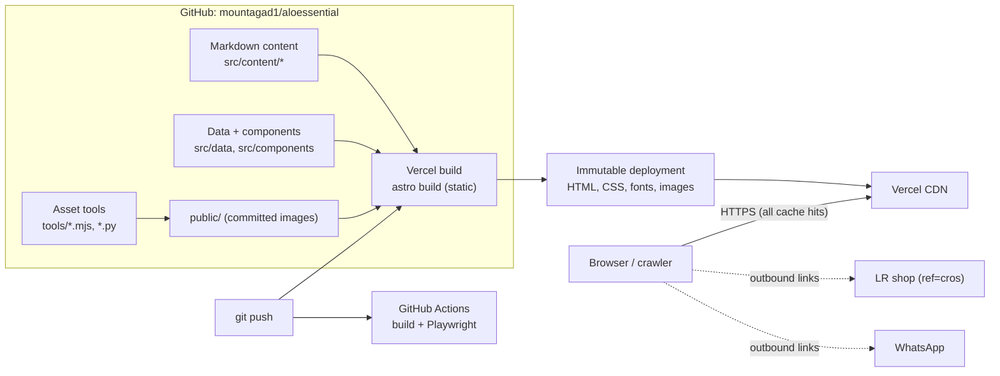
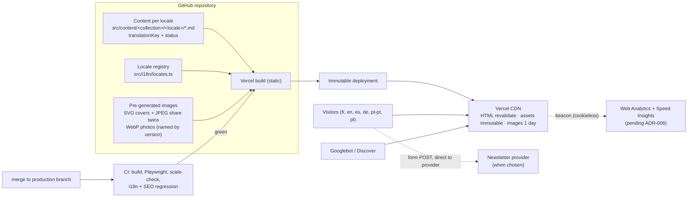

# Target architecture

*2026-10-22. Principle: CDN-first and static. Every component that is not there today has to justify itself with a measured need (ARCHITECTURE_DECISIONS.md).*

## 1. Current state

Request flow for any page: browser → Vercel CDN → cached static file (no origin computation). Redirects (www → apex, missing trailing slash) are answered at the edge.

## 2. Target state (1 M visits/month, six locales)

What changes from today:

| Area | Today | Target | Trigger |
| --- | --- | --- | --- |
| Rendering | 100 % static | **unchanged**: 100 % static, including every locale | — |
| Listings | paginated (done) | paginated per locale | done |
| Locales | fr | fr + translations published one at a time | owner decisions D1–D5 |
| Measurement | none | cookieless analytics + RUM, Search Console | ADR-006 |
| Images | SVG covers + share twins (done) | + licensed photography for key articles, versioned names | content decision |
| Sitemap | single file | sitemap index per locale when > 40 k URLs | scale-check |
| Delivery headers | security + image caching (pending deploy) | same | deploy |
| CI gate | CI runs in parallel with Vercel's production deploy | production deploys only from a protected branch after CI is green | ADR-007 |

What deliberately does **not** appear: database, CMS server, Redis, queue, serverless functions for pages, middleware, ISR, edge personalisation, microservices. None solves a measured problem here (ADR-001 to ADR-004).

## 3. Dynamic workloads (isolation rules)

There are none today. If one is added (newsletter signup, contact form, search):

1. It runs **outside** page rendering: the HTML stays static and cached; the browser calls the endpoint.
2. Prefer the provider's own endpoint (e.g. a newsletter service's form API) over a Vercel function.
3. If a Vercel function is needed: `/api/*` only, `Cache-Control: private, no-store`, input validation, a timeout (≤ 10 s) and at most one retry with backoff toward the third party, rate limiting via Vercel Firewall rules, and a user-visible failure message (the newsletter form already handles errors and timeouts: `src/scripts/newsletter.ts`).
4. A failing endpoint must never break a page: pages do not depend on it.

## 4. Background work

All "background" work happens at authoring time, by tools run locally and committed: cover generation, share-image rasterisation, hero variants, OG default image. A build-time step is preferable to a runtime job; a queue is not warranted (no asynchronous workload exists). If translation becomes a pipeline, it is an authoring workflow (pull requests), not runtime infrastructure.

## 5. Resilience

| Failure | Behaviour |
| --- | --- |
| Build fails | Previous deployment keeps serving; CI shows the failure |
| Bad content or code deployed | Instant rollback to the previous deployment (ROLLBACK_PLAN.md) |
| CDN region issue | Vercel's anycast network routes to another region (provider responsibility) |
| LR shop or WhatsApp down | Outbound links fail on their side; site unaffected |
| Traffic spike | Served from cache; cost rises with bytes and requests, not risk of overload |

## 6. Validation

- The architecture is enforced by tests: no `astro-island`/hydration (`tests/motion.spec.ts`), static checks on SEO, pagination, images and delivery rules (`tests/seo.spec.ts`, `tests/delivery.spec.ts`), catalogue growth (`tools/scale-check.mjs`).
- Capacity: see CAPACITY_MODEL.md and LOAD_TEST_PLAN.md.
